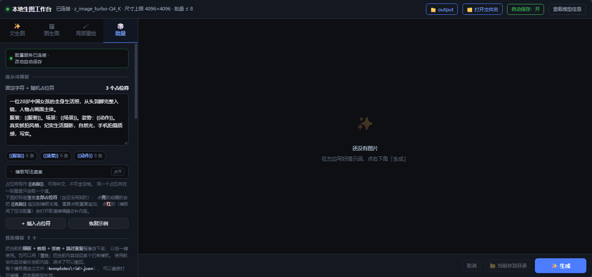

# 本地生图工作台

[](https://opensource.org/licenses/MIT)

基于 [stable-diffusion.cpp](https://github.com/leejet/stable-diffusion.cpp) 的本地图像生成前端：
一个**单文件 Web UI**（无构建步骤）+ 一个负责配置持久化的 **Node 小服务**。
全部跑在本机，不出网、不依赖云服务。



> **本项目由 vibe coding 完成** —— 通过与 AI 结对开发（AI 生成 + 人工审阅、测试驱动）。
> 结构追求轻量实用，不引入框架与构建链。改动前请先看文末「更多文档」。

---

## 快速开始

```bat
tools\serve.cmd
```

一条命令同时拉起两个进程并自动打开浏览器：

| 服务 | 端口 | 作用 |
|---|---|---|
| `sd-server.exe` | 1234 | 生图（stable-diffusion.cpp 的 HTTP 服务） |
| `serve-config.mjs` | 1235 | 配置读写（Node） |

停止：`tools\stop.cmd`

```bat
tools\serve.cmd            :: Z-Image Turbo（默认，质量最好）
tools\serve.cmd sd15       :: SD 1.5（快，512px）
tools\serve.cmd z 1234     :: 指定端口
```

模型怎么装见[模型安装](docs/模型安装.md)。

---

## 四种模式

| 模式 | 说明 |
|---|---|
| **文生图** | 标准出图，含预设提示词、比例快选 |
| **图生图** | 以已有图为起点，可调重绘强度 |
| **局部重绘** | 画笔涂蒙版，只重画涂抹区域 |
| **批量** | 模板 + `{{占位符}}` 数组，一次出多张不重复组合 |

另外：历史记录、点击放大（滚轮缩放 / 拖动平移）、保存目录管理、
在资源管理器打开目录、**在终端跑批量任务（可关掉浏览器）**。

---

## 批量生图

模板里用 `{{名称}}` 做占位符，每张图独立随机取值：

```
服装：{{服装}}。场景：{{场景}}。
```

- 占位符名允许中文，**不能有空格**
- 同名占位符在同一张图内取**同一个值**（否则画面自相矛盾）
- 「跳过重复组合」开启时，张数不能超过组合总数
- 占位符没有对应数组 / 数组为空 / `{{` 未闭合 → 实时标红 + 点生成时硬拦

> 面板上有「**模板写法速查**」（默认收起），两种写法、命名规则、
> 可直接抄的最小示例都在里面。

**标签行三态** —— 模板框下面那行标签列出全部占位符：

| 状态 | 含义 | 点击 |
|---|---|---|
| **亮** | 已配置 + 已在模板里用 | 把 `{{名称}}` 追加到模板末尾 |
| **暗** | 已配置 + 还没用上 | 同上（重复点重复追加） |
| **红** | 模板用了但没配取值 | 打开取值编辑器去补内容 |

**取值编辑器**：点「✏️ 编辑占位符取值」打开弹窗，**左侧选占位符、右侧编辑**（带行号）。
批量面板上只留一览标签，占位符多了也不会把页面撑长。

### 可选占位符（出现概率）

槽位可以配出现概率，实现「有时戴眼镜、鞋子必穿」这类效果：

```
{{#眼镜}}眼镜：{{眼镜}}；{{/眼镜}}鞋子（必穿）：{{鞋子}}。
```

- `{{#名称}}…{{/名称}}` 是**条件块**：该槽位本次不出现时，整块（含标签）一起删除
- 概率填 1%~99% 为可选，留空 / 100% 为必选；填 0 被拒（永不出现没有意义）
- 有可选槽位时「跳过重复组合」会被**自动禁用并置灰**（去重会扭曲概率分布）
- 可选占位符没包条件块 → **黄色提醒**（不是错误，不拦生成），因为缺席时会留下空标签

> 一个占位符 = 一个语义槽。互斥的东西（如「穿袜子」和「穿丝袜」）应合并成一个占位符，
> 否则两张图可能同时渲染出两个并列标签，模型分不清层级。

### 模板库

可存多套模板（模板 + 数组 + 张数 + 开关整套保存），支持「使用 / 覆盖 / 改名 / 删除」，
**数量不设上限**。使用前自动备份当前内容，可一键撤回。

每个模板是**独立文件**（`app\ui\templates\<id>.json`）—— 可以直接打开编辑，
改完刷新即生效，不会被别处的保存覆盖。批量面板里有「📂 模板文件夹」按钮直达该目录。

**「恢复示例」**：把模板与数组换回出厂的**教学示例**（3 个占位符，288 组合）。
它只是示例、不是推荐配置；恢复前会自动备份，可一键撤回。已存的模板不受影响。

---

## 在终端跑批量（关掉浏览器也能继续）

批量面板底部「**在终端运行这一批**」：UI 把当前这一批的完整快照交给配置服务，
配置服务拉起一个终端跑 `tools\batch-run.mjs`，**这时候浏览器可以关掉**，生成照常进行。

按钮会告诉你接下来是「继续」还是「开新批」：有未完成批次且匹配时，
按钮变成「**🖥 继续（2/5）**」，旁边仍可开新批。

> 这里的「继续 / 新批」是**终端脚本**的动作，和 UI 自己的批量续跑是两套独立进度。

```bat
node tools\batch-run.mjs                      :: 用 config.json 的模板与张数（开新批）
node tools\batch-run.mjs --count 3 --w 128 --h 128 --steps 2
node tools\batch-run.mjs --resume             :: 续跑上次未完成批次
node tools\batch-run.mjs --list               :: 只打印计划，不出图
node tools\batch-run.mjs --out-dir D:\pics    :: 覆盖保存目录
node tools\batch-run.mjs --job <任务文件>      :: UI 下发的完整任务
node tools\batch-run.mjs --help
```

按模板库里的模板跑：

```bat
node tools\batch-run.mjs --list-templates              :: 列出模板库
node tools\batch-run.mjs --template 裙子女生·竖版        :: 按名字（支持唯一前缀）
node tools\batch-run.mjs --template tpl_xxx --count 5  :: 按 id，张数可覆盖
```

**断点续跑**：进度记在保存目录的 `.batch-cli-state.json`。默认总是开新批；
只有明确 `--resume` 才续跑，续跑按旧快照、改动提示词不丢失旧批次。

> **前提**：`sd-server` 和 `serve-config.mjs` 要活着（`tools\serve.cmd` 会一起拉起）。
> 关掉的是**浏览器**，不是这两个服务。

---

## 运行前提

- **Windows x64**（脚本是 `.cmd` / `.ps1`）
- 支持 **Vulkan** 的显卡（AMD / NVIDIA / Intel 均可；纯 CPU 也能跑，只是慢）
- **Node.js**（只用于配置服务和测试，不参与生图）
- 模型文件：见[模型安装](docs/模型安装.md)

`app\runtime\` 里是 stable-diffusion.cpp 的预编译产物，自带 MIT 许可证
（`ggml.txt`、`stable-diffusion.cpp.txt`）。本项目源码以 **MIT License** 开源（见 `LICENSE`）。

---

## 跑测试

```bat
npm install        :: 首次一次即可（只装 jsdom）
npm test           :: 跑全部测试并汇总（约 1 分钟）
```

每个测试**自带隔离环境**：自己起一个「临时配置 + 临时模板库 + 空闲端口」的
配置服务，跑完自己关。所以**不需要预先起服务、不需要传端口**，
也**不会碰**你的 `app\ui\config.json` 和 `app\ui\templates\`。

测试模式带 `SDCFG_NO_OPEN=1`：`/open-dir` 的校验照常走，
但**不会真的弹出资源管理器窗口**。

单个测试可直接跑，同样无需前置步骤：

```bat
node tests\test-slot-engine.mjs     :: 占位符引擎（纯逻辑，最快）
node tests\test-e2e-jsdom.mjs       :: DOM 端到端
node tests\test-slot-dlg.mjs        :: 占位符取值弹窗
node tests\test-open-dir.mjs        :: 配置服务接口 + 安全边界
```

> 测试不得依赖个人数据（个人模板库里的某个模板、固定端口、固定盘符路径、
> `%TEMP%` 里手装的 jsdom）。需要「一个多槽模板」这类素材时自己造固定装置。

---

## 更多文档

| 文档 | 内容 |
|---|---|
| [技术说明](docs/技术说明.md) | 技术选型与权衡、为什么用 sd-server、为什么 UI 是单文件 |
| [模型安装](docs/模型安装.md) | 装哪些模型、放哪、从哪下载、文件名硬要求 |
| [目录结构说明](docs/目录结构说明.md) | 目录组织、运行架构、配置服务接口、终端批量实现细节 |
| [批量生图模块-设计规格](docs/批量生图模块-设计规格.md) | 批量生图模块的完整设计规格与实测经验 |
| [单文件 UI 协作指南](docs/单文件UI协作指南.md) | **Agent 版**：怎么安全改单文件 UI、命名 / 作用域 / 测试链路规则 |
